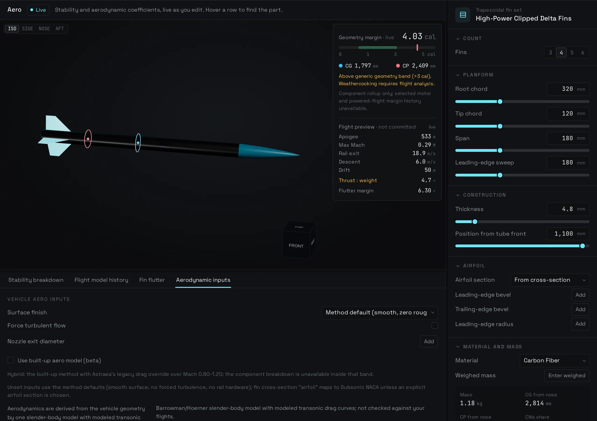
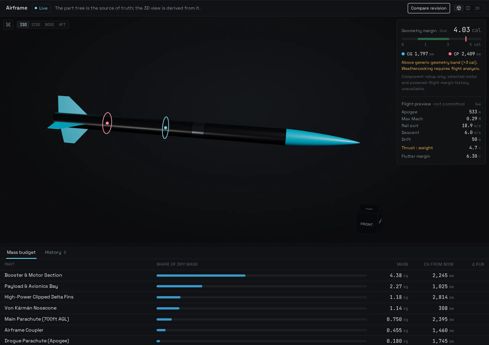
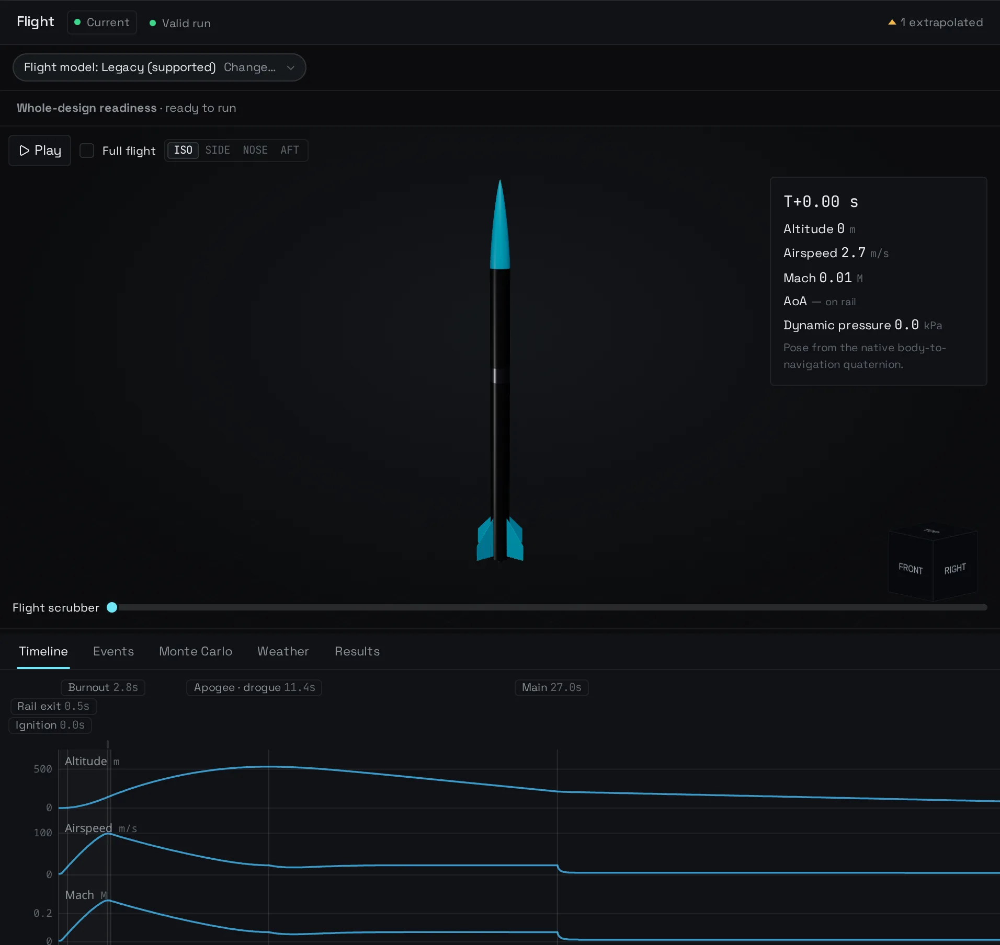
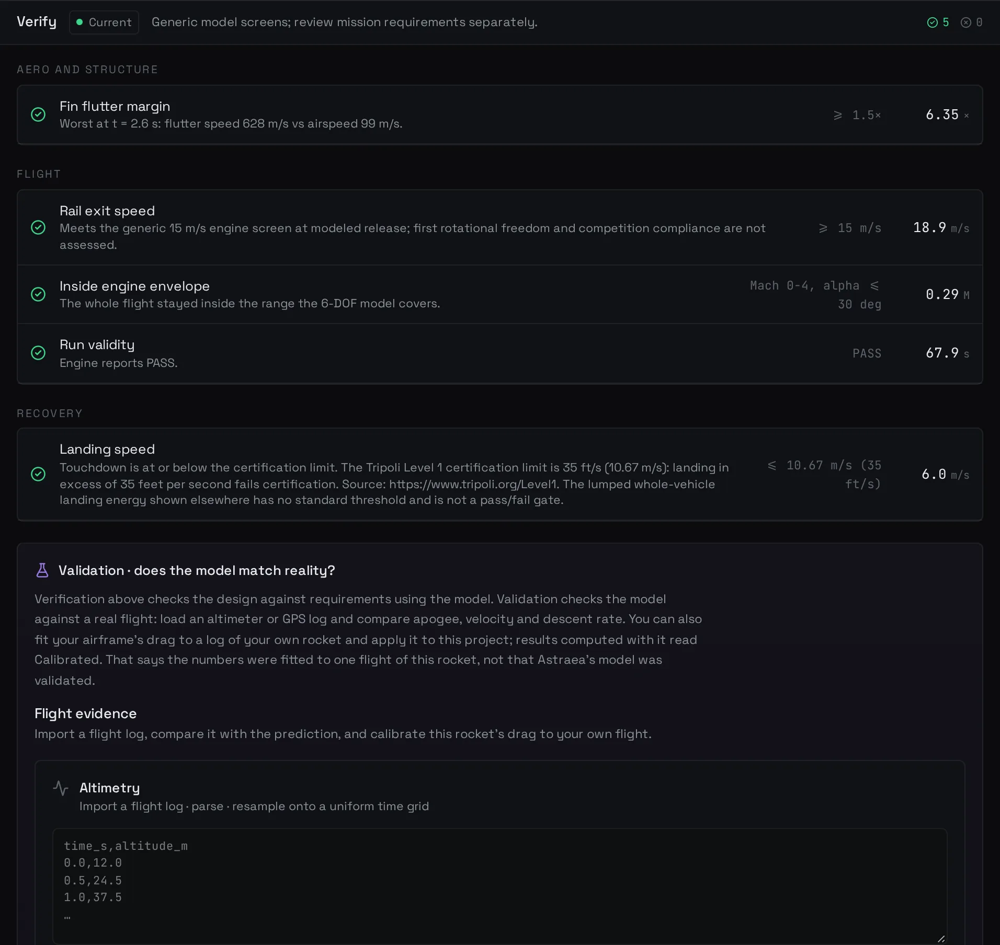
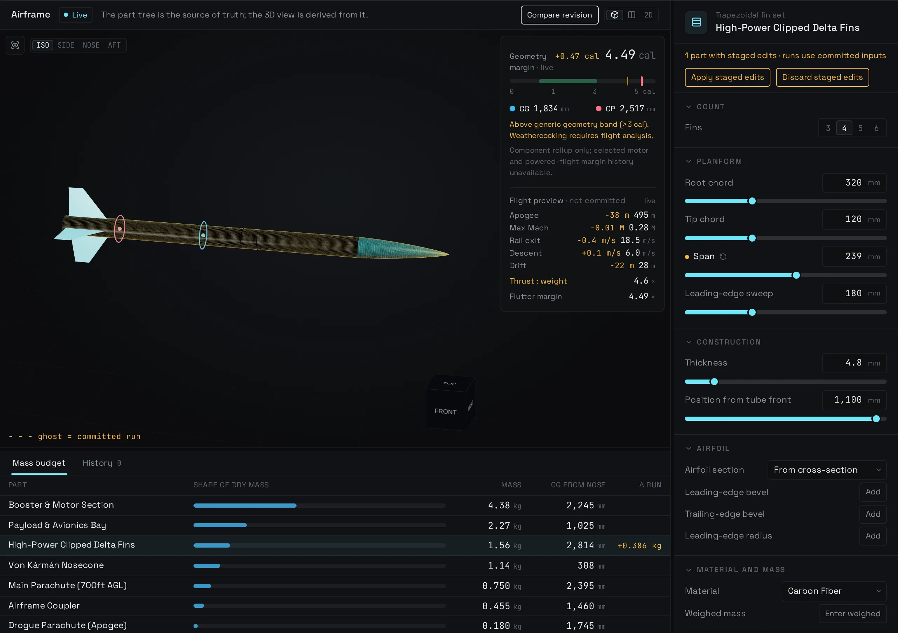

<p align="center">
  
</p>

<h1 align="center">Astraea</h1>

<p align="center">
  <strong>An open-source rocket engineering workstation.</strong><br>
  Design the airframe, fly it in 6-DOF, measure the dispersion, and compare the
  prediction with a real flight — in one browser or desktop app.
</p>

<p align="center">
  <a href="LICENSE"></a>
  <a href="CHANGELOG.md"></a>
  
  
</p>

<p align="center">
  <a href="https://astraea-5e2.pages.dev/app/"><strong>Open in your browser</strong></a> ·
  <a href="https://astraea-5e2.pages.dev/">Website</a> ·
  <a href="https://github.com/akhan157/astraea/releases/tag/v0.10.1">Desktop beta downloads</a>
</p>

Astraea is a high-power rocketry workstation with one computational engine for
the browser and the desktop. It covers the whole loop: parametric airframe
design, mass and stability, motor selection, 6-DOF flight, recovery, Monte Carlo
dispersion, and evidence from real flight logs.

> **0.10 beta — not flight approval.** The legacy flight model was tested blind
> on one small subsonic rocket, where predictions ran 6–10 % high. The built-up
> aero model is a panels-only beta; its flight path is held while validation
> continues. See the [accuracy record](docs/accuracy.md) for tested cases and
> known limits before using any number operationally.

## Screenshots

| Design | Aero |
|---|---|
|  |  |
| **Flight** | **Verify** |
|  |  |

**Live sizing.** Drag a dimension slider and the preview follows while you move:
mass, balance, stability, and the built-up aero coefficients update before the
edit is committed. The 3D view keeps the last solved shape on screen while the
next result lands, so the rocket does not disappear mid-drag.



## What it does

- **Design** — edit the airframe in 3D with live mass, balance, and stability.
  Every dimension also has a slider: dragging stages the edit and updates the
  numbers as you move. Parts, materials, wall thickness, fin planforms, and
  measured masses are first class inputs; the 3D view is derived from the part
  tree.
- **Aero** — Barrowman stability and a built-up drag method with explicit inputs
  for surface finish, forced turbulence, nozzle exit, rail guides, lugs, launch
  shoes, fin airfoil sections, bevels, and leading-edge radius.
- **Propulsion** — pick a certified motor, import an `.eng` or `.rse` thrust
  curve, or explore chamber, nozzle, grain, and propellant design panels.
- **Flight** — run 6-DOF ascent, recovery, weather, and Monte Carlo dispersion
  with the native engine; scrub the timeline, inspect events, and read the
  flight-model history.
- **Verify** — check stability, flutter, rail exit, envelope, landing speed, and
  run validity against explicit thresholds, with the reason and the way to fix
  a failure next to each result.
- **Evidence** — import a flight log, compare it with the prediction, fit drag to
  this rocket's own flight, and export a flight bundle with inputs and provenance.
- **Share** — save `.astraea.json` projects, import OpenRocket/RockSim designs,
  and export STEP, STL, drawings, CSV, KML, and a flight bundle.

The app is intentionally evidence-first: unsupported imports and model terms are
refused or shown as unknown rather than silently defaulted, and every gate keeps
its threshold, status, and reason in the exported trace.

## Quick start

**Browser app**

```sh
git clone https://github.com/akhan157/astraea.git
cd astraea
rustup target add wasm32-unknown-unknown   # the engine is built as WebAssembly
pnpm install --frozen-lockfile
pnpm dev                                    # landing page at http://localhost:5173
```

Open `http://localhost:5173/app/` for the workstation. Use Node.js 24, the pnpm
version pinned in `package.json`, and stable Rust.

**Desktop app**

Install the [Tauri prerequisites](https://v2.tauri.app/start/prerequisites/) for
your OS, then:

```sh
pnpm tauri dev       # development desktop shell
pnpm tauri build     # MSI/NSIS on Windows, bundles on macOS/Linux
```

Prebuilt beta installers for Windows, macOS and Linux are on the
[v0.10.1 release](https://github.com/akhan157/astraea/releases/tag/v0.10.1).
They are not code-signed yet.

**Checks**

```sh
pnpm exec tsc --noEmit
pnpm test                                   # engine + Vitest
cargo test --manifest-path crates/astraea-core/Cargo.toml
cargo test --manifest-path crates/astraea-engine/Cargo.toml --locked
pnpm build && pnpm test:browser             # production build + real WASM flight
```

On memory-constrained machines run checks sequentially, cap Rust with
`CARGO_BUILD_JOBS=2`, and cap Vitest with `--maxWorkers=2`. Details are in
[CONTRIBUTING.md](CONTRIBUTING.md).

## Architecture

```text
React + TypeScript console (src/console)
        │
        ├── browser  ──► WebAssembly boundary (crates/astraea-engine)
        └── desktop  ──► Tauri IPC ──► astraea-engine
                                           │
                                           ▼
                              astraea-core (Rust)
                              stability · aero · 6-DOF · dispersion
```

- [`crates/astraea-core`](crates/astraea-core) — the single runtime compute path:
  geometry, mass, Barrowman stability, calibrated aero, 6-DOF flight, recovery,
  Monte Carlo, and qualification.
- [`crates/astraea-engine`](crates/astraea-engine) — serialization, commands, and
  the WASM boundary shared by the web and desktop apps.
- [`src/console`](src/console) — the workstation UI: stage rail, part tree,
  workspace, inspector, charts, gates, and evidence panels.
- [`src-tauri`](src-tauri) — the desktop shell; native file dialogs and packaging.
- `src/aero`, `src/sim`, `src/dynamics` — TypeScript oracles used by tests; the
  app never routes a prediction through them.

The browser app and desktop app use the same Rust engine and the same project
format. A `.astraea.json` project opens in either one.

## Project status

- **0.10 beta.** The web app is live at
  [astraea-5e2.pages.dev](https://astraea-5e2.pages.dev/); desktop installers are a
  [pre-release](https://github.com/akhan157/astraea/releases/tag/v0.10.1). Not flight approval.
- **Windows** is verified in a Windows 11 VM (install, launch, production CSP,
  flight, persistence). **macOS** acceptance is still pending. The Linux desktop
  build needs WebKitGTK; the browser app is the supported Linux path today.
- **Built-up aero is a panels-only beta.** It is off by default, labelled hybrid
  inside Mach 0.80–1.20, and its flight path is held; flights still use the
  legacy model and refuse to run while the beta is selected.
- **Landing speed** is checked against the Tripoli Level 1 certification limit
  (35 ft/s / 10.67 m/s), cited in the gate. Landing energy is shown as a lumped
  readout; no standard energy threshold is applied.
- **No vendor software, binaries, or sample flight data are shipped.** Development
  flight diagnostics stay outside the repository and are opt-in.

Roadmap and acceptance records are internal engineering records under
`docs/internal/`.

## Contributing

Correctness and honest evidence come before features. Physics changes need a
cited method or an independent comparison, and fail-closed behavior is the
default. Read [CONTRIBUTING.md](CONTRIBUTING.md) for setup, the one-engine rule,
and the review checklist.

- [Report a bug or simulation difference](https://github.com/akhan157/astraea/issues)
- [Security policy](SECURITY.md)
- [Code of conduct](CODE_OF_CONDUCT.md)
- [Changelog](CHANGELOG.md)
- [Accuracy and validation](docs/accuracy.md)

## License

Apache-2.0. See [LICENSE](LICENSE).
